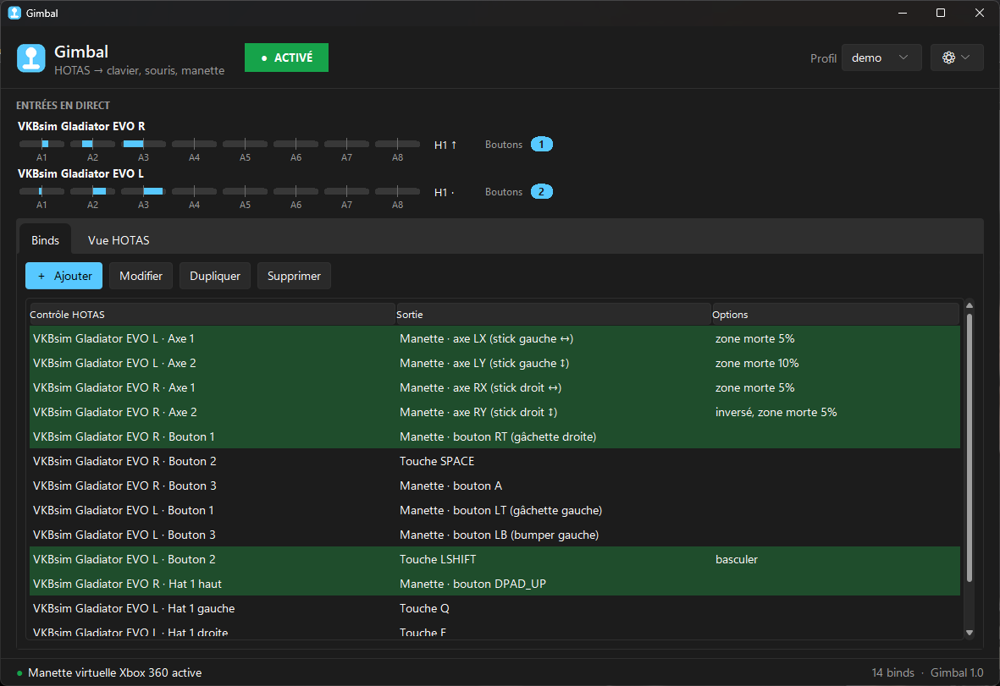
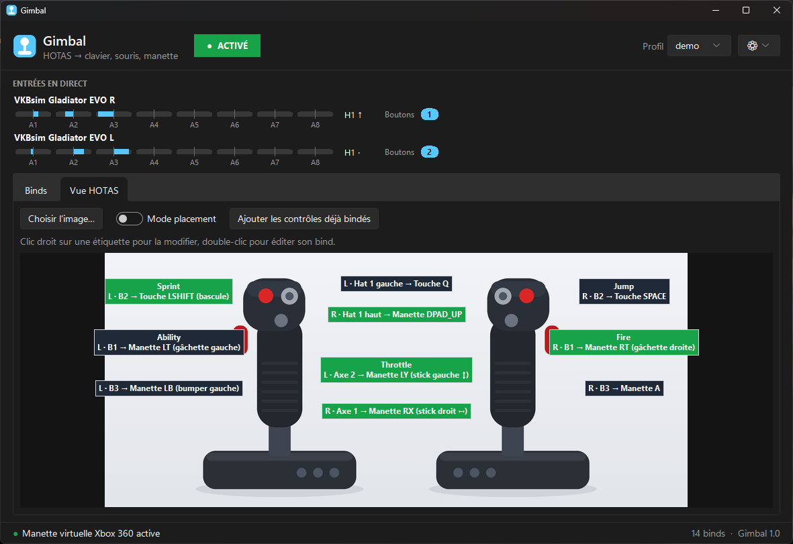
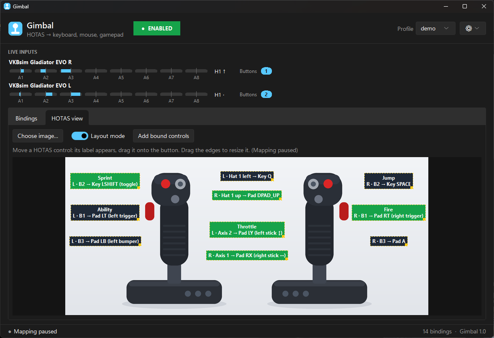
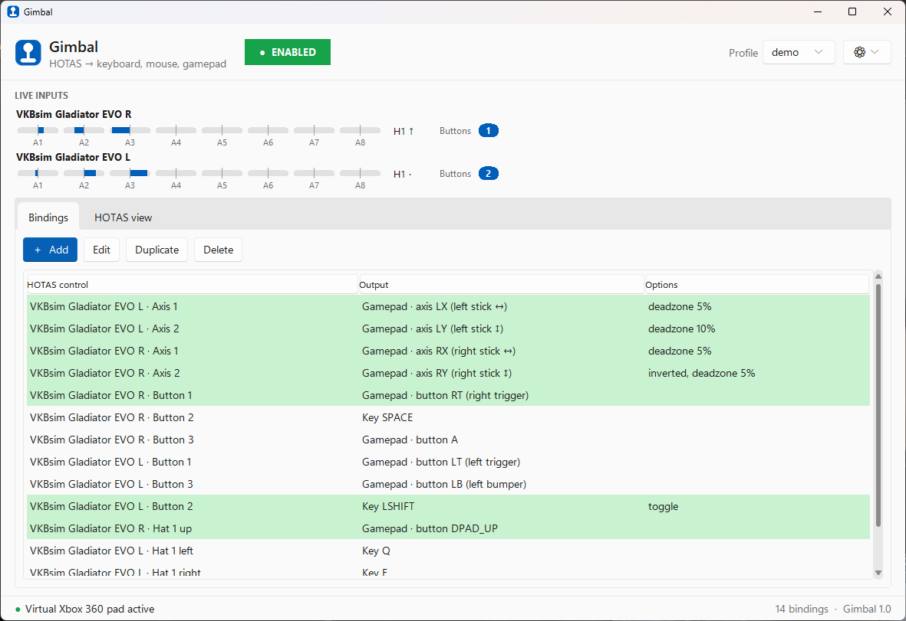
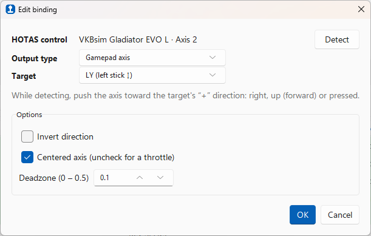

<p align="center">
  
</p>

<h1 align="center">Gimbal</h1>

<p align="center">
  <b>Joue à n'importe quel jeu avec ton HOTAS.</b><br>
  Une appli Windows légère qui transforme ton joystick, ta manette des gaz et ton palonnier en touches clavier, en souris ou en manette Xbox virtuelle.
</p>

<p align="center">
  
  
  
  <a href="README.md"></a>
</p>

<p align="center">
  
</p>

---

Beaucoup de jeux ne gèrent pas les joysticks de vol, surtout les jeux de mechs, de vaisseaux ou de véhicules pensés pour la manette. **Gimbal** tourne en arrière-plan et traduit ton HOTAS en commandes que ces jeux comprennent. Tu appuies sur un bouton de ton stick, et le jeu voit une touche, un clic de souris ou un bouton de manette Xbox.

Joy2Key ou Joystick Gremlin savent aussi le faire, mais ils demandent un temps d'apprentissage. Gimbal mise sur la **simplicité** : une fenêtre, un bouton « Détecter », et c'est réglé.

## Fonctionnalités

- 🕹️ **Compatible avec tous les HOTAS** : VKB, Thrustmaster, Logitech/Saitek, Virpil, Winwing, palonniers, boîtiers de boutons… Tout ce que Windows reconnaît comme contrôleur de jeu. Plusieurs périphériques en même temps (HOSAS, stick + gaz + palonnier) sont pris en charge.
- 🎯 **« Détecter », puis tu bouges le contrôle** : pas besoin de connaître les numéros d'axes ou de boutons.
- ⌨️ **Sortie clavier et souris** : n'importe quelle touche, les boutons et la molette de la souris, et le mouvement de la souris depuis un axe. Les touches sont envoyées en scancodes, donc les jeux qui lisent les entrées brutes les acceptent.
- 🎮 **Manette Xbox 360 virtuelle** : axes vers les sticks analogiques et les gâchettes, boutons vers A/B/X/Y, les bumpers ou la croix. Le jeu voit une vraie manette.
- 🎚️ **Options par bind** : inversion, zone morte, axe de manette des gaz (course complète), seuil pour utiliser un axe comme bouton, mode bascule, vitesse de la souris.
- 🖼️ **Vue HOTAS** : charge une image de ton HOTAS, pose une étiquette sur chaque bouton physique et vois d'un coup d'œil ce que fait chaque commande. Les étiquettes s'allument quand tu actionnes le contrôle. Laisse-la sur un deuxième écran pendant que tu joues.
- 💾 **Profils** : un fichier JSON par jeu, sauvegardé automatiquement.
- 🌓 **Thème clair / sombre** (ou celui de Windows) et interface en **français / anglais**.
- ⏯️ **Activation / désactivation en un clic** pour rendre ton HOTAS aux jeux qui le gèrent nativement.

## Captures d'écran

| Vue HOTAS | Mode placement |
|:---:|:---:|
|  |  |
| **Thème clair** | **Éditeur de bind** |
|  |  |

## Installation

### 1. Prérequis

- **Windows 10 ou 11**
- **[Python 3.10 ou plus récent](https://www.python.org/downloads/windows/)**. Pendant l'installation, coche *« Add python.exe to PATH »*.
- **[Pilote ViGEmBus](https://github.com/nefarius/ViGEmBus/releases)**, seulement si tu veux la manette Xbox virtuelle. Les sorties clavier et souris fonctionnent sans. Le projet ViGEmBus n'est plus maintenu, mais sa dernière version fonctionne toujours sous Windows 10 et 11.

### 2. Télécharger Gimbal

Clique sur **Code → Download ZIP** en haut de cette page et extrais le dossier où tu veux, ou clone le dépôt :

```bash
git clone https://github.com/AbsoluteTheoG/GIMBAL.git
```

### 3. Installer les dépendances

Ouvre un terminal **dans le dossier de Gimbal** et lance :

```bash
py -m pip install --target libs -r requirements.txt
```

Les dépendances s'installent dans un dossier `libs` à côté de l'appli. Gimbal reste ainsi autonome et ne touche pas à tes autres projets Python. Un simple `pip install -r requirements.txt` fonctionne aussi.

### 4. Lancer

Double-clique sur **`gimbal.pyw`**. C'est tout.

> **Astuce :** clic droit sur `gimbal.pyw` → *Envoyer vers → Bureau (créer un raccourci)* pour avoir une icône sur le bureau.

## Prise en main

1. **Branche ton HOTAS.** Il apparaît dans *Entrées en direct*, en haut, avec ses jauges d'axes, la direction des hats et les boutons appuyés en temps réel.
2. Dans l'onglet **Binds**, clique sur **＋ Ajouter**.
3. Clique sur **Détecter**, puis appuie sur le bouton ou bouge l'axe que tu veux utiliser.
4. Choisis un **Type de sortie** et une **Cible** : une touche (clique sur *Capturer une touche* et appuie dessus), un bouton ou un axe de manette, ou le mouvement de la souris.
5. Clique sur **OK**. Le bind est actif tout de suite et enregistré dans le profil.
6. Lance ton jeu. Quand un bind est utilisé, sa ligne passe en vert.

Le gros bouton **ACTIVÉ / DÉSACTIVÉ** de l'en-tête met Gimbal en pause à tout moment. La pause relâche toutes les touches et débranche la manette virtuelle.

## Les binds en détail

### Types de sortie

| Sortie | Ce que reçoit le jeu | Usage typique |
|---|---|---|
| **Touche clavier / souris** | Une touche, un bouton de souris ou un cran de molette | Actions, menus, capacités |
| **Bouton manette** | Un bouton de manette Xbox 360 virtuelle (A, B, X, Y, LB, RB, LT, RT, croix, Start, Back…) | Jeux jouables uniquement à la manette |
| **Axe manette** | Un axe de stick (LX, LY, RX, RY) ou une gâchette (LT, RT) | Déplacement, visée, accélérateur |
| **Mouvement souris** | Le déplacement de la souris en X ou en Y, à vitesse réglable | Viser dans les jeux qui exigent une souris |

Un axe peut aussi piloter un **bouton**. Poussé au-delà d'un seuil, il agit comme un appui. Par exemple, stick vers l'avant = maintenir `Z`.

### Options

| Option | S'applique à | Rôle |
|---|---|---|
| **Inverser le sens** | Sorties analogiques | Inverse l'axe. La détection le règle toute seule si tu pousses l'axe dans le sens « + » de la cible (droite, haut/avant, appui). |
| **Zone morte** | Axes → analogique | Ignore les petits mouvements autour de la position de repos (5 % par défaut). |
| **Axe centré** | Axes → analogique | À décocher pour une **manette des gaz** ou un curseur. L'axe couvre alors toute sa course : une butée = 0, l'autre = 100 %. |
| **Seuil de déclenchement** | Axes → boutons/touches | Jusqu'où pousser l'axe pour que l'appui compte (50 % par défaut). |
| **Basculer** | Boutons/touches | Un appui active la sortie, l'appui suivant la désactive. Pratique pour le sprint ou l'accroupissement. |
| **Vitesse** | Mouvement souris | Pixels par seconde quand l'axe est à fond. |

Plusieurs binds peuvent viser la même sortie ; leurs valeurs s'additionnent. Un même contrôle peut aussi porter plusieurs binds, par exemple stick vers l'avant → `Z` et vers l'arrière → `S`.

## Vue HOTAS

<p align="center">
  
</p>

L'onglet **Vue HOTAS** est un aide-mémoire visuel de ta config :

1. Clique sur **Choisir l'image…** et prends une photo, un rendu ou un schéma de ton HOTAS (PNG, JPG…). L'image est copiée dans `profiles/images/`.
2. Active le **Mode placement**. Le mapping est en pause pendant l'édition.
3. Appuie sur un bouton ou bouge un axe. Son étiquette apparaît, avec ce que fait le contrôle, ou *libre*.
4. **Glisse** l'étiquette sur le contrôle physique. **Tire sur ses bords ou ses coins** pour la redimensionner.
5. **Ajouter les contrôles déjà bindés** crée d'un coup les étiquettes de tous tes binds.
6. Désactive le mode placement. Les étiquettes restent en place et **s'allument en vert** quand tu utilises le contrôle.

Un clic droit sur une étiquette permet de modifier son bind, d'en ajouter un, de la renommer (par exemple « Tir » ou « Boost »), de lui rendre sa taille automatique ou de la retirer. Un double-clic ouvre directement son bind.

## Profils

Les profils sont des fichiers JSON rangés dans le dossier `profiles/`. Chaque modification est sauvegardée automatiquement, et le dernier profil se rouvre au lancement suivant. Le menu **Profil** de l'en-tête permet de créer, d'ouvrir ou de dupliquer (*Enregistrer sous…*) un profil. Tu peux par exemple en garder un par jeu.

Les binds retiennent le **nom** du périphérique auquel ils appartiennent. Si tu changes de HOTAS, crée un nouveau profil et refais la détection.

Des profils d'exemple sont dans [`profiles/examples/`](profiles/examples/) :

- `vkb_war_robots.json` : VKB Gladiator EVO L + R (un stick converti en manette des gaz) pour *War Robots: Frontiers*, avec la manette Xbox virtuelle.

N'hésite pas à partager les tiens !

## Réglages

Le menu **⚙** de l'en-tête permet de choisir :

- le **thème** : Système (suit Windows), Clair ou Sombre ;
- la **langue** : Français ou English. Par défaut, c'est la langue de Windows.

Les changements s'appliquent tout de suite, sans redémarrer.

## Astuces et dépannage

<details>
<summary><b>Il ne se passe rien quand je double-clique sur <code>gimbal.pyw</code></b></summary>

Cherche un fichier `gimbal_error.log` à côté de l'appli. Toute erreur au démarrage y est écrite et s'affiche aussi dans une boîte de dialogue. La cause la plus fréquente : des dépendances manquantes. Relance la commande d'installation de l'étape 3 dans le dossier de Gimbal. Si Gimbal tourne déjà, un nouveau double-clic ramène simplement sa fenêtre au premier plan.
</details>

<details>
<summary><b>« Manette virtuelle indisponible »</b></summary>

Le pilote ViGEmBus n'est pas installé. Installe-le depuis la [page des versions de ViGEmBus](https://github.com/nefarius/ViGEmBus/releases), puis relance Gimbal. Les binds clavier et souris continuent de fonctionner sans.
</details>

<details>
<summary><b>Mes touches ne marchent pas dans un jeu</b></summary>

- Si le jeu tourne **en administrateur**, Windows bloque les entrées des applis normales. Lance aussi Gimbal en administrateur.
- Certains jeux avec un **anti-triche** ignorent ou interdisent les entrées virtuelles. Gimbal ne peut pas contourner ça, et il ne faut pas essayer.
</details>

<details>
<summary><b>Le jeu réagit en double, ou les icônes des touches changent sans arrêt</b></summary>

- Sur Steam, désactive **Steam Input** pour ce jeu, ou décoche *Prise en charge des manettes génériques*. Sinon Steam risque de mapper aussi ton HOTAS.
- Mélanger les sorties clavier et manette fait alterner les icônes à l'écran dans certains jeux. Mieux vaut choisir un seul type de sortie par jeu.
</details>

<details>
<summary><b>J'ai deux périphériques identiques</b></summary>

Deux périphériques identiques, par exemple deux sticks du même modèle en HOSAS, portent le même nom. Gimbal les distingue en `Nom` et `Nom #2`, dans l'ordre où Windows les liste, et cet ordre peut changer après un débranchement. Les périphériques aux noms distincts, comme les sticks L/R de VKB, ne sont pas concernés.
</details>

## Comment ça marche

- Lit tous les contrôleurs de jeu à **250 Hz** via SDL ([pygame-ce](https://github.com/pygame-community/pygame-ce)), même quand la fenêtre du jeu a le focus.
- Envoie le clavier et la souris avec l'API Windows `SendInput`, en **scancodes**, pour que les jeux DirectInput et Raw Input les acceptent.
- Crée une **manette Xbox 360** virtuelle avec [vgamepad](https://github.com/yannbouteiller/vgamepad) et le pilote [ViGEmBus](https://github.com/nefarius/ViGEmBus), seulement quand un profil utilise des sorties manette.
- Interface en Tkinter avec le [thème Sun Valley](https://github.com/rdbende/Sun-Valley-ttk-theme).

Toute l'appli tient dans un seul fichier Python, [`gimbal.pyw`](gimbal.pyw).

```
GIMBAL/
├── gimbal.pyw            # l'appli
├── requirements.txt
├── profiles/
│   └── examples/         # profils d'exemple partagés
├── docs/                 # logo et captures d'écran
└── libs/                 # dépendances, créé par l'installation (pas dans git)
```

## Contribuer

Rapports de bugs, idées et pull requests sont les bienvenus ! Pour les gros changements, ouvre d'abord une [issue](https://github.com/AbsoluteTheoG/GIMBAL/issues). Les profils d'exemple pour d'autres HOTAS et d'autres jeux sont particulièrement appréciés.

## Licence

Gimbal est distribué sous [licence MIT](LICENSE).

Il s'appuie sur ces projets : [pygame-ce](https://github.com/pygame-community/pygame-ce) (LGPL-2.1), [vgamepad](https://github.com/yannbouteiller/vgamepad) (MIT), [ViGEmBus](https://github.com/nefarius/ViGEmBus) (BSD-3-Clause), [Pillow](https://github.com/python-pillow/Pillow) (MIT-CMU) et le [thème Sun Valley](https://github.com/rdbende/Sun-Valley-ttk-theme) (MIT).
