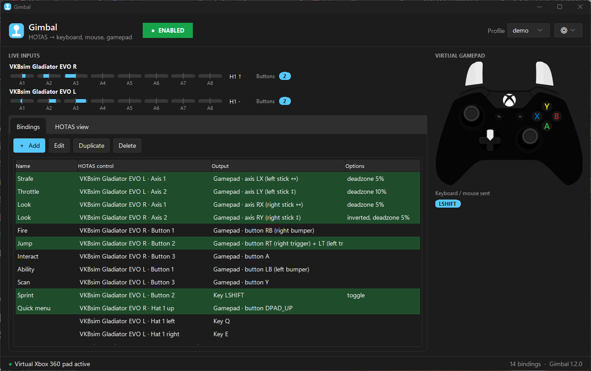
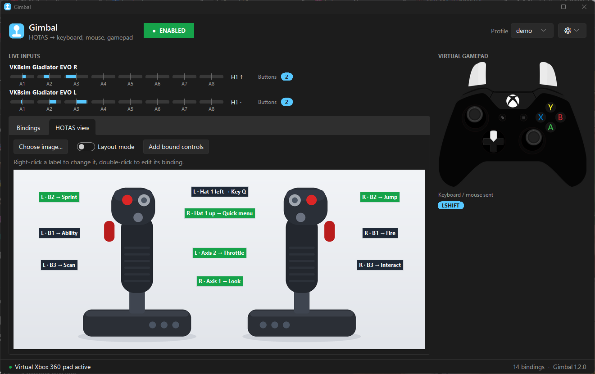
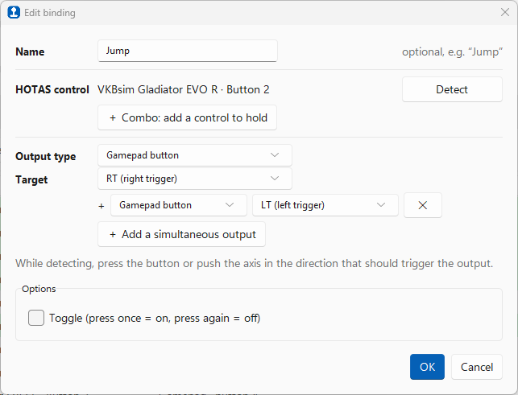

<p align="center">
  
</p>

<h1 align="center">Gimbal</h1>

<p align="center">
  <b>Play any game with your HOTAS.</b><br>
  A lightweight Windows app that turns your joystick, throttle and pedals into keyboard keys, mouse input or a virtual Xbox controller.
</p>

<p align="center">
  
  
  
  <a href="README.fr.md"></a>
</p>

<p align="center">
  
</p>

---

Lots of games don't support flight sticks natively, especially mech, space and vehicle games that were designed for a gamepad. **Gimbal** sits in the background and translates your HOTAS into the inputs those games understand. You press a button on your stick, and the game sees a key, a mouse click or an Xbox controller button.

Tools like Joy2Key or Joystick Gremlin can do this too, but they take a while to learn. Gimbal is built to be **simple**: one window, a "Detect" button, and you're done.

## Features

- 🕹️ **Works with any HOTAS**: VKB, Thrustmaster, Logitech/Saitek, Virpil, Winwing, pedals, button boxes… Anything Windows sees as a game controller. Several devices at once (HOSAS, stick + throttle + pedals) are supported.
- 🎯 **Click "Detect", move the control**: no need to know axis or button numbers.
- ⌨️ **Keyboard and mouse output**: any key, mouse buttons, mouse wheel, and mouse movement from an axis. Keys are sent as scancodes, so games that read raw input accept them.
- 🎮 **Virtual Xbox 360 controller**: map axes to the analog sticks and triggers and buttons to A/B/X/Y, bumpers or the D-pad. The game sees a real gamepad.
- 🔗 **Combos and multi-outputs**: hold several HOTAS controls together to trigger a binding (even across two sticks), and send several buttons or keys at once from a single press (e.g. **RT + LT**, **Ctrl + C**).
- 🏷️ **Named bindings**: call a binding "Jump" or "Boost" and see it in the list and on the HOTAS view.
- 🎚️ **Per-binding options**: invert, deadzone, throttle (full-range) axes, trigger threshold for using an axis as a button, toggle mode, mouse speed.
- 👀 **Live gamepad view**: an Xbox controller on the main screen shows exactly what the game receives (buttons, sticks, triggers) and which keys are being sent. Great for checking a binding, or for showing your inputs on stream.
- 🖼️ **HOTAS view**: load a picture of your HOTAS, drop labels on each physical button, and see at a glance what everything does. Labels light up when you press the control. Keep it on a second screen while you play.
- 💾 **Profiles**: one JSON file per game, saved automatically.
- 🌓 **Light / dark theme** (or follow Windows) and **English / French** interface.
- ⏯️ **One-click on/off** to give your HOTAS back to games that support it natively.

## Screenshots

| HOTAS view | Layout mode |
|:---:|:---:|
|  |  |
| **Light theme** | **Binding editor** |
|  |  |

## Installation

### Download (recommended)

1. Go to the **[latest release](https://github.com/AbsoluteTheoG/GIMBAL/releases/latest)** and download `Gimbal-vX.Y.Z-windows-x64.zip`.
2. **Extract** the zip somewhere you can write to. Avoid `Program Files`, because Gimbal saves its profiles next to the exe.
3. Double-click **`Gimbal.exe`**. No Python needed.
4. *Optional:* install the **[ViGEmBus driver](https://github.com/nefarius/ViGEmBus/releases)** if you want the virtual Xbox controller. Keyboard and mouse output work without it. The ViGEmBus project is no longer maintained, but the last release still works on Windows 10 and 11.

> **"Windows protected your PC"?** Gimbal isn't code-signed (certificates are expensive for a free hobby project), so SmartScreen may warn you the first time. Click **More info → Run anyway**. Prefer to check the code yourself? Run it from source, below.

> **Tip:** right-click `Gimbal.exe` → *Send to → Desktop (create shortcut)* to get a desktop icon.

### Run from source

Requires **Windows 10/11** and **[Python 3.10 or newer](https://www.python.org/downloads/windows/)**. During setup, tick *"Add python.exe to PATH"*.

```bash
git clone https://github.com/AbsoluteTheoG/GIMBAL.git
cd GIMBAL
py -m pip install --target libs -r requirements.txt
```

Then double-click **`gimbal.pyw`**. The dependencies go into a `libs` folder next to the app, so Gimbal stays self-contained and doesn't touch your other Python projects. A regular `pip install -r requirements.txt` works too.

## Quick start

1. **Plug in your HOTAS.** It shows up under *Live inputs* at the top, with live axis gauges, hat directions and pressed buttons.
2. In the **Bindings** tab, click **＋ Add**.
3. Click **Detect**, then press the button or move the axis you want to use.
4. *Optional:* give the binding a **Name** (for example "Jump").
5. Choose an **Output type** and a **Target**: a key (click *Capture a key* and press it), a gamepad button or axis, or mouse movement.
6. Click **OK**. Your binding is active right away and saved in the profile.
7. Launch your game. While a binding is in use, its row turns green, and the **virtual gamepad** panel on the right shows what the game receives.

Use the big **ENABLED / DISABLED** button in the header to pause Gimbal at any time. Pausing releases every key and unplugs the virtual controller.

## Bindings explained

### Output types

| Output | What the game receives | Typical use |
|---|---|---|
| **Keyboard / mouse key** | A key, a mouse button or a mouse wheel notch | Actions, menus, abilities |
| **Gamepad button** | A button on a virtual Xbox 360 controller (A, B, X, Y, LB, RB, LT, RT, D-pad, Start, Back…) | Gamepad-only games |
| **Gamepad axis** | A stick axis (LX, LY, RX, RY) or a trigger (LT, RT) | Movement, aiming, throttle |
| **Mouse movement** | Mouse movement along X or Y, with adjustable speed | Aiming in games that require a mouse |

Axes can drive **buttons** too. Push an axis past a threshold and it acts like a button press. For example, stick forward can hold `W`.

### Options

| Option | Applies to | Meaning |
|---|---|---|
| **Invert direction** | Analog outputs | Flips the axis. Detection sets it for you if you push the axis toward the target's "+" direction (right, up/forward, pressed). |
| **Deadzone** | Axes → analog | Ignores small movements around the rest position (default 5%). |
| **Centered axis** | Axes → analog | Untick for a **throttle** or slider. The axis then covers its full travel: one end = 0, the other end = 100%. |
| **Trigger threshold** | Axes → buttons/keys | How far the axis must be pushed before it counts as pressed (default 50%). |
| **Toggle** | Buttons/keys | One press turns the output on, the next press turns it off. Handy for sprint or crouch. |
| **Speed** | Mouse movement | Pixels per second at full deflection. |

Several bindings can target the same output; their values are added. One control can also have several bindings, for example stick forward → `W` and stick back → `S`.

### Combos and simultaneous outputs

<p align="center">
  
</p>

- **Simultaneous outputs.** Click **＋ Add a simultaneous output** to send several gamepad buttons or keys from one press. Example for *No Man's Sky*, where jumping needs **RT + LT**: one HOTAS button → `RT` + `LT`. Keyboard shortcuts work too (`LCTRL` + `C`): modifiers are pressed first and released last, so the game receives a proper shortcut.
- **HOTAS combos.** Click **＋ Combo: add a control to hold** and press another control. The binding only fires while **all** its controls are held, even if they're on two different devices.
- **Combos win over simpler bindings.** If `B1` alone does Y and `B1 + B2` does X, pressing the combo sends **only X**, like a Shift key. Use this to build extra "layers" of commands on the same buttons.
- On an axis binding, combo controls act as a **lock**: the axis only works while they're held.

Combos and simultaneous outputs can be mixed freely, for example two HOTAS buttons → `RT` + `LT`.

## HOTAS view

<p align="center">
  
</p>

The **HOTAS view** tab is a visual cheat sheet of your setup:

1. Click **Choose image…** and pick a photo, render or diagram of your HOTAS (PNG, JPG…). The picture is copied into `profiles/images/`.
2. Turn on **Layout mode**. The mapping pauses while you edit.
3. Press a button or move an axis. Its label appears, showing what the control does, or *unbound*.
4. **Drag** the label onto the physical control. **Drag its edges or corners** to resize it.
5. **Add bound controls** creates labels for all your existing bindings in one go.
6. Turn layout mode off. Labels stay in place and **light up green** when you use the control.

Right-click a label to edit its binding, add another one, rename it (for example "Fire" or "Boost"), reset its size or remove it. Double-click a label to edit its binding directly.

## Profiles

Profiles are JSON files stored in the `profiles/` folder. Every change is saved automatically, and the last profile reopens on the next launch. Use the **Profile** menu in the header to create, open or duplicate (*Save as…*) a profile. You might keep one per game.

Bindings remember the **name** of the device they belong to. If you switch to a different HOTAS, create a new profile and detect your controls again.

Example profiles live in [`profiles/examples/`](profiles/examples/):

- `vkb_war_robots.json`: VKB Gladiator EVO L + R (one stick converted to a throttle) for *War Robots: Frontiers*, using the virtual Xbox controller.

Feel free to contribute yours!

## Settings

The **⚙** menu in the header lets you choose:

- **Theme**: System (follows Windows), Light or Dark
- **Language**: English or Français. The default follows your Windows language.

Changes apply instantly, without restarting.

## Tips & troubleshooting

<details>
<summary><b>Nothing happens when I double-click <code>gimbal.pyw</code></b></summary>

Look for a `gimbal_error.log` file next to the app. Any startup error is written there and also shown in a dialog. When running from source, the most common cause is missing dependencies: re-run the `pip install` command in the Gimbal folder. If Gimbal is already running, double-clicking again just brings its window to the front.
</details>

<details>
<summary><b>"Virtual pad unavailable"</b></summary>

The ViGEmBus driver isn't installed. Install it from the [ViGEmBus releases page](https://github.com/nefarius/ViGEmBus/releases) and restart Gimbal. Keyboard and mouse bindings keep working without it.
</details>

<details>
<summary><b>My keys don't work in a game</b></summary>

- If the game runs **as administrator**, Windows blocks input from normal apps. Run Gimbal as administrator too.
- Some games with **anti-cheat** systems ignore or forbid virtual input. Gimbal can't work around that, and you shouldn't try.
</details>

<details>
<summary><b>The game reacts twice, or the on-screen button prompts keep switching</b></summary>

- On Steam, disable **Steam Input** for that game, or turn off *Generic gamepad support*. Otherwise Steam may also map your HOTAS.
- Mixing keyboard and gamepad outputs makes some games switch their on-screen prompts back and forth. Prefer one output style per game.
</details>

<details>
<summary><b>I have two identical devices</b></summary>

Identical devices, such as two of the same stick for a HOSAS setup, share the same name. Gimbal tells them apart as `Name` and `Name #2`, in the order Windows lists them, and that order can change after unplugging. Devices with distinct names, like VKB's L/R sticks, aren't affected.
</details>

## How it works

- Reads every game controller at **250 Hz** through SDL ([pygame-ce](https://github.com/pygame-community/pygame-ce)), even while the game window has focus.
- Sends keyboard and mouse input with the Windows `SendInput` API, using **scancodes** so DirectInput and Raw Input games accept them.
- Creates a virtual **Xbox 360 controller** with [vgamepad](https://github.com/yannbouteiller/vgamepad) and the [ViGEmBus](https://github.com/nefarius/ViGEmBus) driver, only when a profile uses gamepad outputs.
- Interface built with Tkinter and the [Sun Valley ttk theme](https://github.com/rdbende/Sun-Valley-ttk-theme).

The whole app is a single Python file, [`gimbal.pyw`](gimbal.pyw).

```
GIMBAL/
├── gimbal.pyw            # the app
├── requirements.txt
├── tools/
│   └── build_release.py  # builds Gimbal.exe and the release zip
├── profiles/
│   └── examples/         # shared example profiles
├── docs/                 # logo and screenshots
└── libs/                 # dependencies, created by the install step (not in git)
```

### Building the .exe

```bash
py -m pip install pyinstaller -r requirements.txt
py tools/build_release.py
```

This creates `dist/Gimbal-vX.Y.Z-windows-x64.zip`, taking the version from `APP_VERSION` in `gimbal.pyw`.

## Contributing

Bug reports, ideas and pull requests are welcome! Please open an [issue](https://github.com/AbsoluteTheoG/GIMBAL/issues) first for bigger changes. Example profiles for other HOTAS and games are especially appreciated.

## License

Gimbal is released under the [MIT License](LICENSE).

It relies on these projects: [pygame-ce](https://github.com/pygame-community/pygame-ce) (LGPL-2.1), [vgamepad](https://github.com/yannbouteiller/vgamepad) (MIT), [ViGEmBus](https://github.com/nefarius/ViGEmBus) (BSD-3-Clause), [Pillow](https://github.com/python-pillow/Pillow) (MIT-CMU) and [Sun Valley ttk theme](https://github.com/rdbende/Sun-Valley-ttk-theme) (MIT). The virtual gamepad images are derived from the Xbox One template of [Gamepad Viewer](https://github.com/e7d/gamepad-viewer) by Michaël "e7d" Ferrand (MIT, see [`assets/gamepad/LICENSE`](assets/gamepad/LICENSE)).
